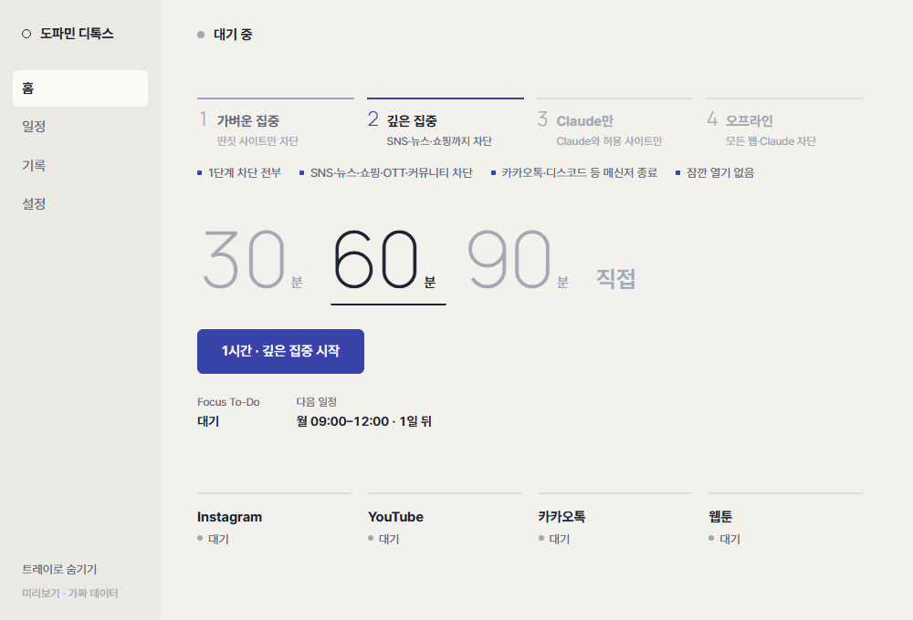
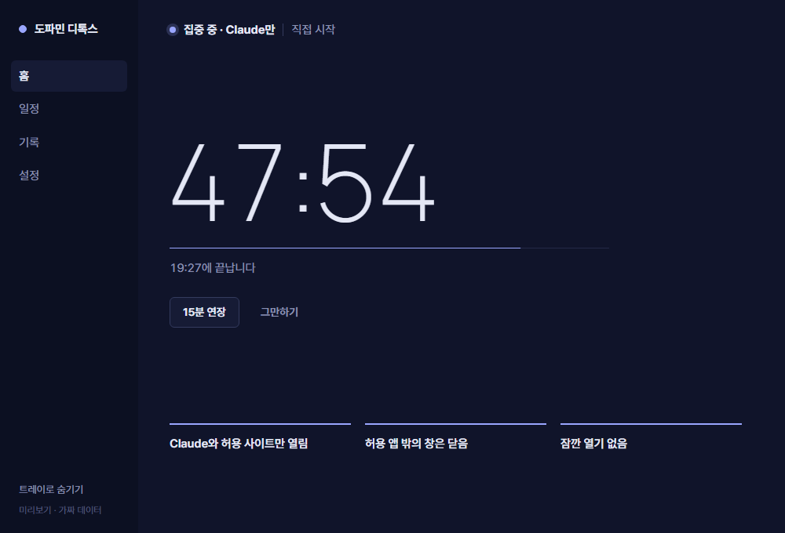

# 도파민 디톡스 (Dopamine Detox)

노트북에서 공부·업무에 몰입하도록, 정해진 시간 동안 딴짓을 막아 주는 Windows 데스크톱 앱입니다.
상황에 맞는 **집중 강도(4단계)** 를 하나 골라 시작하고, Focus To-Do에서 포모도로를 시작하면 자동으로 차단이 걸립니다.

| 대기 — 단계와 시간 고르기 | 집중 중 — 3단계 "Claude만" |
|---|---|
|  |  |

---

## 집중 강도 (v2)

집중 강도는 **하나만** 고릅니다. 단계마다 웹·Claude·앱·예외가 한꺼번에 정해져서, "인터넷은 막았는데 유튜브는 허용" 같은 모순된 조합은 만들 수 없습니다. 위 단계는 아래 단계가 막는 것을 전부 포함해 더 막습니다.

| 단계 | 웹 | Claude | 앱 | 잠깐 열기 | 어울리는 상황 |
|---|---|---|---|---|---|
| 1 가벼운 집중 | Instagram·YouTube·웹툰 차단 | 사용 | 카카오톡 종료 | 가능 (하루 3회) | 자료 찾으며 공부 |
| 2 깊은 집중 | 1단계 + SNS·뉴스·쇼핑·OTT·커뮤니티 차단 | 사용 | 메신저 종료 | 없음 | 혼자 과제·보고서 |
| 3 Claude만 | **Claude와 허용 사이트만** 열림 | 사용 | **허용 앱만** | 없음 | AI와 코드·글 작업 |
| 4 오프라인 | **모든 웹 차단** | 불가 | **허용 앱만** | 없음 | 시험공부, 손으로 쓰기 |

- 고칠 수 있는 목록은 그 목록이 의미 있는 단계에서만 쓰입니다: 허용 사이트 → 3단계, 허용 앱 → 3·4단계, 잠깐 열기 → 1단계, AI 경고 → 1·2단계.
- 1·2단계 차단 대상(예: youtube.com)은 3단계 허용 사이트에 **넣을 수 없습니다**.
- 일정·Focus To-Do 연동도 각각 어느 단계로 켤지 고릅니다. 여러 개가 겹치면 **가장 엄격한 단계**가 적용됩니다.
- 3·4단계를 시작하거나 끝낼 때 웨일을 **자동으로 다시 시작**합니다(열려 있던 탭은 다시 열림). 실행 중인 웨일은 차단 정책 변경을 바로 반영하지 않기 때문입니다.

## 주요 기능

- **차단 시간 정하기**
  - 지금 시작: 30 / 60 / 90분 또는 직접 입력
  - 반복 일정: 요일 + 시각 (예: 월~금 09:00–12:00)
  - **Focus To-Do 연동**: 포모도로가 돌면 자동 차단, 일시정지·정지하면 해제 (하단 미니 타이머·전체 화면 타이머 모두 지원, 창을 최소화해도 남은 시간만큼 유지)
- **차단 대상**
  - Instagram, YouTube, 웹툰(네이버·카카오·카카오페이지·레진 등) — 브라우저에서 접속 차단 + 이미 열린 탭 자동 닫기
  - 카카오톡 — 차단 중에는 실행되면 바로 종료
  - 설정에서 막을 주소를 직접 추가 가능
- **공부용으로 잠깐 열기** — YouTube·카카오톡만, 사유를 적고 10~60분, 하루 3회까지
- **엄격 모드** — 중간에 멈추려면 정해진 문장을 그대로 입력해야 함. 집중 중에는 차단을 약하게 만드는 설정 변경·앱 종료 불가
- **AI 업무 관련성 경고** — 집중 중 5분마다 맨 앞 창 제목을 Claude(haiku)가 판정해, 업무와 무관하면 알림 (선택 기능, 기본 꺼짐)
- **기록** — 오늘 집중 시간, 막은 횟수, 최근 7일 그래프, 잠깐 열기 내역

---

## 설치

### 요구 사항
- Windows 10 / 11 (64비트)
- Microsoft Edge WebView2 런타임 — Windows 11에는 기본 포함. 없으면 [WebView2 런타임](https://developer.microsoft.com/microsoft-edge/webview2/)을 설치
- 관리자 권한 (브라우저 차단 정책을 쓰는 데 필요)
- 선택: [Focus To-Do](https://www.focustodo.cn/) Windows 앱 (포모도로 연동), [Claude Code](https://docs.claude.com/en/docs/claude-code) CLI 로그인 (AI 경고)

### exe로 설치 (권장)
1. 이 저장소의 **Releases**에서 `DopamineDetox.exe`를 내려받습니다.
2. 원하는 곳(예: 바탕화면)에 두고 실행합니다.
3. **사용자 계정 컨트롤(UAC)** 창에서 **예**를 누릅니다.
4. "Windows의 PC 보호" 창이 뜨면 **추가 정보 → 실행**을 누릅니다. (코드 서명이 없는 개인 프로젝트라 뜨는 경고입니다.)

> 로그인할 때마다 자동으로 켜려면 앱의 **설정 → 시스템 → 로그인 시 자동 실행**을 켜세요. 작업 스케줄러에 관리자 권한으로 등록되어 매번 UAC 창이 뜨지 않습니다.

### 소스에서 실행
```bash
git clone https://github.com/hbean00/dopamine-detox.git
cd dopamine-detox
pip install pywebview pystray pillow psutil uiautomation pyinstaller
python app.py            # 관리자 권한 터미널에서 실행
```

### 직접 빌드
```bash
python build.py          # dist/DopamineDetox.exe 생성 + 바탕화면에 복사 (관리자 권한 요구 manifest 포함)
python build.py --test   # 관리자 권한 요구 없는 검증용 빌드 (build/testdist/)
```

---

## 사용법

### 1. 집중 시작
- **홈** 위쪽에서 집중 단계(1~4)를 고릅니다. 고른 단계의 규칙이 바로 아래에 보입니다.
- 30 / 60 / 90분을 고르거나 "직접"에 분을 입력하고 **집중 시작**을 누릅니다.
- 3·4단계는 웨일을 다시 시작한다는 확인 창이 먼저 뜹니다. 작성 중인 글은 먼저 저장하세요.
- 집중 중에는 앱 화면이 남색으로 바뀌고, 남은 시간과 차단 대상 카드가 보입니다.
- **15분 연장**으로 늘릴 수 있고, **그만하기**로 멈춥니다(엄격 모드면 문장 입력 필요).

### 2. 반복 일정
- **일정** 탭에서 요일, 시작·끝 시각, 집중 단계를 넣고 추가합니다. 그 시간이 되면 그 단계로 자동 차단됩니다.

### 2-1. 3·4단계 준비 (허용 사이트·허용 앱)
- **설정 → 집중 단계**에서
  - 허용 사이트(3단계): Claude(claude.ai·claude.com·anthropic.com)는 항상 열림. 학교 LMS·메일 등 꼭 필요한 곳을 한 줄에 하나씩 추가
  - 허용 앱(3·4단계): 기본값은 VS Code, Word·한글·PDF, Notion·Obsidian, 터미널. **열린 앱 불러오기**로 지금 켜진 앱을 눌러 추가
  - 탐색기·이 앱·Focus To-Do·브라우저는 항상 허용 (3단계는 Claude 앱도). 허용 밖 앱의 창은 닫고, 10초 넘게 버티면 종료합니다

### 3. Focus To-Do 연동
- Focus To-Do 앱을 켜 두고 평소처럼 포모도로를 시작하면 자동으로 차단이 걸립니다. 어느 단계로 걸지는 **설정 → 집중 단계 → Focus To-Do 포모도로 시작 시**에서 고릅니다.
- 휴식 시간에도 막고 싶으면 **설정 → 연동 → 휴식 중에도 차단**을 켭니다.
- 연동이 이상하면 **설정 → 연동 진단**을 눌러 앱이 Focus To-Do 화면에서 무엇을 읽는지 확인합니다.

### 4. 공부용으로 잠깐 열기
- 1단계로 집중 중일 때만 YouTube·카카오톡 카드의 **공부용으로 잠깐 열기** → 사유(예: "강의 영상 시청")와 시간을 고릅니다.
- 시간이 끝나면 자동으로 다시 막힙니다. 하루 횟수는 설정에서 바꿀 수 있습니다(기본 3회).

### 5. AI 업무 관련성 경고 (선택)
1. [Claude Code](https://docs.claude.com/en/docs/claude-code) CLI를 설치하고 로그인합니다 (`claude` 명령이 실행되어야 함).
2. **설정 → AI 경고**에서 켜고, "지금 하는 업무"를 적습니다 (예: `ASIC 설계 보고서 작성`).
3. **시험하기**로 직전에 보던 창을 바로 판정해 볼 수 있습니다.
- 보내는 정보: 업무 설명 + 맨 앞 창 제목 + 프로그램 이름 (화면 내용·URL은 보내지 않음)
- 비용: MCP·도구를 끈 최소 호출로 1회 약 900토큰 (haiku)

### 6. 창 닫기와 종료
- 창의 X = 트레이로 숨기기. 트레이 아이콘을 더블클릭하면 다시 열립니다.
- 완전 종료는 트레이 아이콘 우클릭 → **종료** (집중 중에는 먼저 멈춰야 함).

---

## 차단 원리

| 대상 | 방법 |
|---|---|
| 웹사이트 (기본) | 브라우저 정책 `HKLM\SOFTWARE\Policies\{Naver\Naver Whale, Google\Chrome, Microsoft\Edge}\URLBlocklist`에 차단 도메인을 씀. 3·4단계는 `URLBlocklist: *` (+3단계 `URLAllowlist`). 원래 있던 정책 항목은 건드리지 않음 |
| 허용 앱만 (3·4단계) | 창이 있는 프로그램 중 허용 목록 밖이면 정상 닫기 요청 → 10초 뒤에도 남으면 종료 |
| 웨일 재시작 (3·4단계) | 웨일을 닫은 뒤 세션 파일에서 열려 있던 탭 주소를 읽어, 일반 권한으로 그 주소들을 다시 엶 |
| 이미 열린 탭 | 브라우저 맨 앞 창 제목에 YouTube / Instagram / 웹툰이 보이면 그 탭을 닫음 (Ctrl+W) |
| 웹사이트 (선택) | 설정의 "hosts 파일로도 차단"을 켜면 hosts 파일에도 씀 — AhnLab Safe Transaction 같은 보안 프로그램이 복원 경고를 띄우므로 기본 꺼짐 |
| 카카오톡 | `KakaoTalk.exe`를 2초마다 확인해 종료 |
| Focus To-Do | 공개 API가 없어 UI Automation으로 Focus To-Do 화면의 타이머·버튼 상태를 읽음 |

---

## 알아 둘 점

- 브라우저 상단에 **"조직에서 관리"** 표시가 뜰 수 있습니다. 차단 정책 때문이며 정상입니다. 앱이 차단을 풀면 정책 항목도 지웁니다.
- **이미 켜져 있던 웨일**은 정책 변경을 바로 반영하지 않습니다. 그 사이는 탭 자동 닫기가 막고, 웨일을 다시 켜면 정책 차단도 적용됩니다.
- 차단 대상은 브라우저입니다. 인스타그램 데스크톱 앱처럼 브라우저 밖 앱은 정책이 닿지 않습니다.

## 문제 해결

| 증상 | 확인 |
|---|---|
| 차단이 안 걸림 | 관리자 권한으로 실행했는지 (앱 상단에 경고 배너가 뜨면 권한 없음) |
| 앱을 끈 뒤에도 사이트가 막힘 | 앱을 다시 켜면 시작할 때 정리됨. 수동으로는 레지스트리 `URLBlocklist` 키에서 차단 도메인만 삭제 |
| Focus To-Do 연동이 안 됨 | 설정 → 연동 진단, `log.txt`의 "Focus To-Do 상태" 줄 |
| AI 경고가 안 뜸 | 터미널에서 `claude --version`이 되는지, 설정의 "시험하기" 결과 |

- 데이터: `%APPDATA%\DopamineDetox\data.json`
- 동작 기록: `%APPDATA%\DopamineDetox\log.txt` (차단 시작·해제, 탭 닫음, 정책 갱신, AI 판정, 오류)

---

## 프로젝트 구조

```
app.py                 진입점: pywebview 창 + 트레이 + JS API, --selftest 등 검증 모드
build.py               PyInstaller 빌드 스크립트
engine/
  core.py              차단 엔진 (1초 주기 판단, 세션·일정·연동·허용·기록, 단계 적용)
  levels.py            v2 집중 단계 정의·프리셋 차단 목록·배타성 검사
  appguard.py          3·4단계 허용 앱만 남기기
  browserctl.py        웨일 재시작 (일반 권한으로 다시 실행)
  whalesession.py      웨일 세션 파일에서 열린 탭 주소 읽기
  browserpolicy.py     브라우저 URLBlocklist 정책 쓰기/지우기
  hosts.py             hosts 파일 블록 (선택 기능)
  focustodo.py         Focus To-Do 감지 (UI Automation)
  aiguard.py           AI 업무 관련성 경고 (Claude CLI)
  targets.py           차단 대상 도메인·창 제목 패턴
  store.py             설정·기록 저장
  autostart.py         로그인 시 자동 실행 (작업 스케줄러)
  winutil.py           Win32 도우미
ui/                    HTML / CSS / JS 화면
tests/                 단위 테스트와 실제 환경 검증 스크립트
PLAN.md                v1 구현 계획과 실측 기록
PLAN_v2.md             v2 설계: 상황별 집중 강도
```

### 테스트
```bash
python tests/test_engine.py      # 차단·허용·일정·엄격 모드 (가짜 hosts 사용)
python tests/test_policy.py      # 브라우저 정책 (HKCU 테스트 키 사용)
python tests/test_focustodo.py   # Focus To-Do 판정 (실측 화면 구조 재현)
python tests/test_levels.py      # v2 단계 규칙·배타성·정책·허용 앱·우선순위 (실제 창·웨일은 건드리지 않음)
python tests/test_webview_v2.py  # 실제 앱 창에서 단계 UI ↔ 엔진 연결
python tests/test_webview.py     # 실제 앱 창에서 UI ↔ 엔진 연결
```
